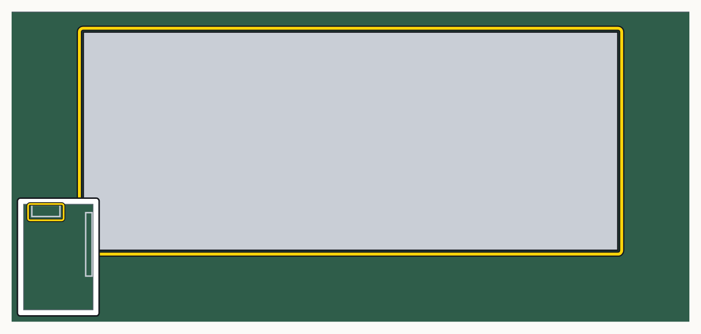
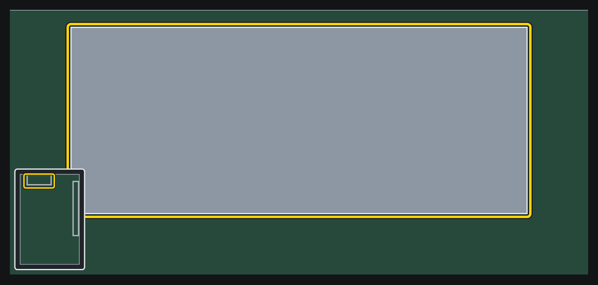
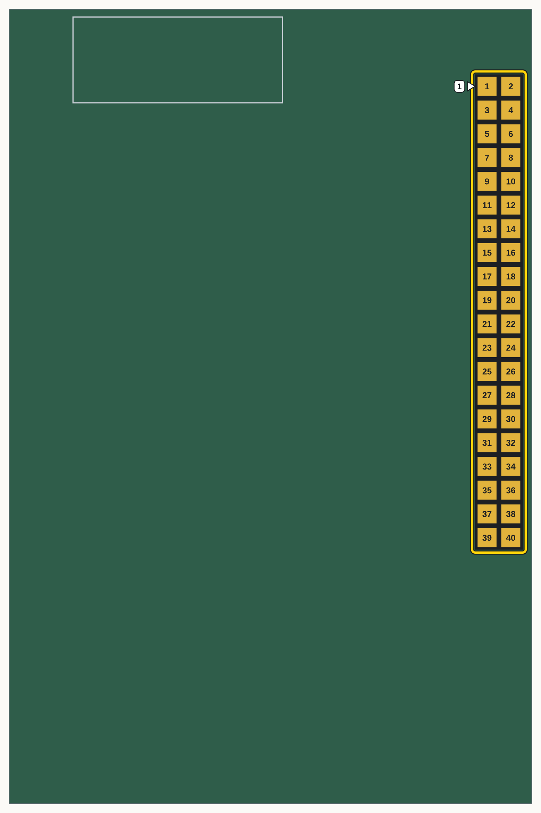
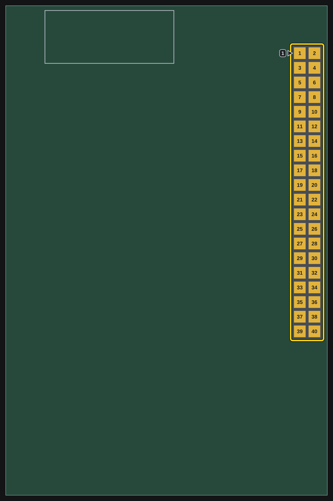

% This page is generated by tools/sync_repos.py from its row in WRAPPERS (test-designs), from files
% of https://github.com/fpgas-online/fpgas.online-test-designs. Do not edit it here: change the row, or those files.

# How to fit the cables and the card (Raspberry Pi 5)

**Your two cables for an Acorn on a Raspberry Pi 5 have passed the bench check, and you are fitting them and the card.**

The card goes in the M.2 slot of the HAT, marked here:

{.only-light}

{.only-dark}

The housings go on the HAT's 40-pin header, marked here with its pin 1. With the stacking header fitted, they go on the pins that come up through the HAT at these places:

{.only-light width="400px"}

{.only-dark width="400px"}

```{include} ../../generated/acorn-build-pi5-fit.md
:relative-images:
```
